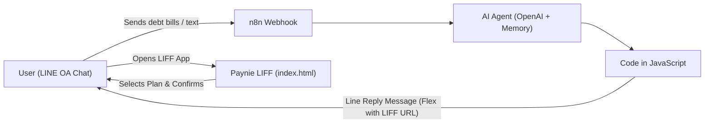

# Paynie - LINE OA Debt Strategist & Financial Companion

An intelligent, interactive financial companion designed to help users aggregate debts, calculate minimum payments with mathematical precision, and simulate personalized payoff strategies (Avalanche vs. Snowball).

Built with **HTML5**, **Tailwind CSS**, **FontAwesome 6**, and **Vanilla JavaScript**, featuring native integration with the **LINE LIFF SDK v2** and optimized for **n8n AI Workflows**.

---

## 📱 Interactive Prototypes (GitHub Pages Demos)

Experience Paynie directly in your browser without requiring a live LINE OA connection:

| Prototype Version | Description & Recommended Device | GitHub Pages URL |
| :--- | :--- | :--- |
| 📱 **Mobile Prototype (Phone View)** | **Recommended for mobile smartphones**<br>Full-screen native-like mobile web view (100% viewport), directly boots into **Phase 2 (Full Financial Companion)** with interactive LINE chat, collapsible Rich Menu, quick replies, zero-PII PDF statement unlock, slide-up LIFF mini-app, and a **`🧪 Flow`** scenario testing menu. | [Launch Mobile Prototype](https://praisepany.github.io/paynie-liff/paynie_line_oa_prototype.html) |
| 💻 **Web-Based Desktop Simulator** | **Recommended for desktop computers & presentations**<br>Side-by-side layout featuring a Left Control Panel (Scenario Controller 1A–6 + Phase 2) and center smartphone mockup. | [Launch Web Simulator](https://praisepany.github.io/paynie-liff/paynie_line_oa_prototype_web_based.html) |
| 📊 **Standalone LIFF Web App** | Production-ready endpoint for registration in **LINE Developers Console** (LIFF). | [Open LIFF App](https://praisepany.github.io/paynie-liff/index.html) |

> 💡 **Note for Personal Repository Deployment**: If deploying to your own GitHub repository, the URLs follow this pattern:
> - `https://<your-username>.github.io/<your-repo-name>/paynie_line_oa_prototype.html`
> - `https://<your-username>.github.io/<your-repo-name>/paynie_line_oa_prototype_web_based.html`

---

## 🌟 Key Features

### 1. Interactive Payoff Scale (Slider)
- Dynamic monthly budget slider with real-time recalculation of total minimum payments and extra payoff budget.
- Automatic boundary scaling based on user's actual debts.
- **Variable Reward Banner**: Real-time feedback displaying exactly how many months faster the user will become debt-free and total interest saved compared to making minimum payments only.

### 2. 3-Way Plan Comparison (Real Amortization Engine)
- **Minimum Payment Trap**: Exposes how long it takes and how much interest accumulates when paying only required minimums.
- **Avalanche Method** *(Highest APR first)*: Optimizes mathematically to save the maximum amount of interest.
- **Snowball Method** *(Smallest Balance first)*: Focuses on quick psychological wins, highlighting which month the first debt will be completely eliminated.

### 3. Monthly Payment Schedule Table
- Categorizes debts into priority order based on the selected strategy.
- Highlights **Rank #1 (Target)** with breakdown of minimum due + extra lump sum payment.
- Action button to confirm plan and send results directly into LINE chat room.
- Direct support link to Bangkok Metropolitan Administration (BMA) Debt Clinic.

### 4. Interactive Debt Portfolio Management (Tab 2)
- Summary card displaying total debt liability and total accounts.
- **Edit Existing Debts ✏️**: Click the pencil icon on any debt to edit creditor name, balance, APR %, minimum %, and due date in a popup modal with real-time recalculation.
- **Delete & Clear All**: Remove individual debts or wipe all items with a single click.
- **Auto-Persistence (No Database Required)**: Automatically saves any added, edited, or deleted debts to LINE In-App Browser `localStorage`. When users open LIFF from the **Rich Menu**, their saved debts reload instantly!

---

## 🏗 System Architecture



---

## 🚀 Deployment Guide

### Step 1: Host Prototypes & LIFF App on GitHub Pages
Deploy this repository to any static hosting provider with HTTPS support:
- **GitHub Pages**: Go to **Settings > Pages > Branch: `main` > `/ (root)` > Save**.
  - **Mobile Prototype (Phone View)**: `https://praisepany.github.io/paynie-liff/paynie_line_oa_prototype.html`
  - **Desktop Simulator (With Flow Controller)**: `https://praisepany.github.io/paynie-liff/paynie_line_oa_prototype_web_based.html`
  - **Production LIFF App**: `https://praisepany.github.io/paynie-liff/` (or `index.html`)
- Alternatively: Vercel, Netlify, Cloudflare Pages, or Firebase Hosting.

### Step 2: Register LIFF in LINE Developers Console
1. Log in to [LINE Developers Console](https://developers.line.biz/).
2. Select your Provider and your **LINE Login** channel.
3. Open the **LIFF** tab and click **Add**.
4. Configure settings:
   - **LIFF app name**: `Paynie Debt Planner`
   - **Size**: `Full` (or `Tall`)
   - **Endpoint URL**: `https://praisepany.github.io/paynie-liff/`
   - **Scopes**: Check `profile` and `chat_message.write`
   - **Bot prompt**: `Normal` or `None`
5. Click **Add** and copy your **LIFF ID** (e.g., `2001234567-abcdefgh`).
6. Your LIFF URL will be `https://liff.line.me/{LIFF_ID}`.

---

## 🔌 Detailed n8n Workflow Integration

Based on your n8n workflow canvas:
```
[ Webhook ] ──▶ [ AI Agent ] ──▶ [ toJsonString ] ──▶ [ Code in JavaScript ] ──▶ [ Line Reply Message ]
                     │
          ┌──────────┴──────────┐
          ▼                     ▼
 [ OpenAI Chat Model ]   [ Simple Memory ]
```

### 1. `AI Agent` Node Configuration

Configure the AI Agent's **System Prompt** so that when the user provides their debts (via text or image analysis), the AI outputs a structured JSON array representing their debts:

```markdown
You are Paynie, a friendly and empathetic financial assistant.
When the user shares debt details (such as credit cards, personal loans, or cash cards):
1. Extract all debt items into a JSON array using this exact format:
[
  {
    "creditor": "KBank Credit Card",
    "balance": 35000,
    "apr": 16.0,
    "minPct": 8.0,
    "dueDay": 25
  }
]

If the user hasn't specified APR or minPct, use standard Thai banking defaults:
- Credit Card: apr = 16.0, minPct = 8.0
- Cash Card: apr = 25.0, minPct = 5.0
- Personal Loan: apr = 22.0, minPct = 6.0

Output the JSON array clearly in your response.
```

---

### 2. `Code in JavaScript` Node (Copy-Paste Ready)

This node takes:
1. The **debts array** extracted by the AI Agent.
2. The `replyToken` from the incoming **Webhook** node.
3. Encodes the debts into a URL-safe Base64 payload.
4. Generates a beautiful LINE Flex Message inviting the user to open the LIFF Planner.

```javascript
// =========================================================================
// 1. CONFIGURATION
// =========================================================================
const LIFF_ID = "YOUR_LIFF_ID"; // Replace with your LIFF ID from LINE Console

// =========================================================================
// 2. EXTRACT DATA FROM PREVIOUS NODES
// =========================================================================
// Get replyToken from the original Webhook trigger
const webhookData = $('Webhook').first().json;
const replyToken = webhookData.body?.events?.[0]?.replyToken;

// Get AI Agent output (from toJsonString or AI Agent)
const agentItem = $input.first().json;
const rawOutput = agentItem.text || agentItem.output || JSON.stringify(agentItem);

// Extract JSON array from AI output using Regex
let debts = [];
try {
  const jsonMatch = rawOutput.match(/\[[\s\S]*?\]/);
  if (jsonMatch) {
    debts = JSON.parse(jsonMatch[0]);
  }
} catch (e) {
  // Fallback default debts if parsing fails
  debts = [
    { creditor: "KBank Credit Card", balance: 35000, apr: 16.0, minPct: 8.0, dueDay: 25 },
    { creditor: "SCB Speedy Cash Card", balance: 22000, apr: 25.0, minPct: 5.0, dueDay: 28 }
  ];
}

// =========================================================================
// 3. BUILD URL-SAFE BASE64 PAYLOAD
// =========================================================================
const jsonStr = JSON.stringify(debts);
// UTF-8 safe Base64 encoding in Node.js
const base64Data = Buffer.from(unescape(encodeURIComponent(jsonStr))).toString('base64');
const liffUrl = `https://liff.line.me/${LIFF_ID}?data=${encodeURIComponent(base64Data)}`;

// Calculate quick summary figures
const totalBalance = debts.reduce((sum, d) => sum + (Number(d.balance) || 0), 0);
const debtCount = debts.length;

// =========================================================================
// 4. CONSTRUCT LINE FLEX MESSAGE PAYLOAD
// =========================================================================
const flexMessage = {
  type: "flex",
  altText: `Paynie analyzed your ${debtCount} debts. Tap to view your payoff plan.`,
  contents: {
    type: "bubble",
    size: "mega",
    header: {
      type: "box",
      layout: "vertical",
      backgroundColor: "#06C755",
      paddingTop: "16px",
      paddingBottom: "16px",
      contents: [
        {
          type: "text",
          text: "PAYNIE DEBT STRATEGIST",
          weight: "bold",
          size: "xxs",
          color: "#FFFFFF",
          letterSpacing: "1px"
        },
        {
          type: "text",
          text: "🌱 Your Personalized Debt Payoff Plan",
          weight: "bold",
          size: "md",
          color: "#FFFFFF",
          margin: "xs"
        }
      ]
    },
    body: {
      type: "box",
      layout: "vertical",
      spacing: "md",
      contents: [
        {
          type: "text",
          text: `Detected ${debtCount} active debt accounts totaling:`,
          size: "xs",
          color: "#666666"
        },
        {
          type: "text",
          text: `฿${totalBalance.toLocaleString('th-TH')}`,
          size: "xl",
          weight: "bold",
          color: "#0F172A"
        },
        {
          type: "box",
          layout: "vertical",
          backgroundColor: "#F8FAFC",
          cornerRadius: "12px",
          paddingAll: "12px",
          spacing: "xs",
          contents: [
            {
              type: "text",
              text: "✨ What you can do in LIFF:",
              size: "xs",
              weight: "bold",
              color: "#334155"
            },
            {
              type: "text",
              text: "• Adjust monthly budget slider to what you can afford",
              size: "xxs",
              color: "#64748B"
            },
            {
              type: "text",
              text: "• Compare Avalanche (maximum interest saved) vs Snowball",
              size: "xxs",
              color: "#64748B"
            },
            {
              type: "text",
              text: "• Get prioritized monthly payment schedule",
              size: "xxs",
              color: "#64748B"
            }
          ]
        }
      ]
    },
    footer: {
      type: "box",
      layout: "vertical",
      spacing: "sm",
      contents: [
        {
          type: "button",
          style: "primary",
          color: "#06C755",
          height: "sm",
          action: {
            type: "uri",
            label: "📊 View Plan & Schedule",
            uri: liffUrl
          }
        }
      ]
    }
  }
};

// Return payload formatted for LINE Reply API
return [
  {
    json: {
      replyToken: replyToken,
      messages: [flexMessage]
    }
  }
];
```

---

### 3. `Line Reply Message` Node Configuration

Configure this HTTP Request node to reply to the user:
- **Method**: `POST`
- **URL**: `https://api.line.me/v2/bot/message/reply`
- **Authentication**: `Generic Credential Type` > `Header Auth`
  - Name: `Authorization`
  - Value: `Bearer YOUR_LINE_CHANNEL_ACCESS_TOKEN`
- **Send Body**: `true`
- **Body Content Type**: `JSON`
- **Specify Body**: `Using JSON`
- **JSON**:
  ```json
  {{ JSON.stringify({
    replyToken: $json.replyToken,
    messages: $json.messages
  }) }}
  ```

---

### 4. Handling Plan Selection Callback in n8n

When the user taps **"Confirm Plan & Send Schedule to LINE Chat"** in LIFF:
1. `liff.sendMessages()` sends a formatted message back into the chat room from the user's account:
   ```text
   🎯 Confirmed Plan: Avalanche Method (Highest APR first)
   💰 Monthly Budget: ฿9,000/month
   ⏳ Debt-Free Timeframe: 1 Year 4 Months
   🎉 Total Interest Saved: ฿12,450

   📋 This Month's Priority #1:
   👉 SCB Speedy Cash Card: Total Payment ฿4,115 (Minimum ฿1,100 + Extra ฿3,015)
   ```
2. LINE Messaging API triggers the **Webhook** node in your n8n workflow.
3. The **AI Agent** receives this confirmation message, allowing it to:
   - Save the chosen plan and budget to database or Google Sheets.
   - Reply with an encouraging cheer and set a calendar payment reminder.

---

## 📋 Data Schema Reference

The LIFF app accepts debts encoded in URL query parameters via `?data=` (Base64) or `?debts=` (URI-encoded JSON):

```json
[
  {
    "id": "debt_1",
    "creditor": "KBank Credit Card",
    "balance": 35000,
    "apr": 16.0,
    "minPct": 8.0,
    "dueDay": 25
  }
]
```

| Field | Type | Description | Default |
|---|---|---|---|
| `creditor` *(or `name`)* | String | Name of bank, financial institution, or card | `"Debt Account #N"` |
| `balance` | Number | Total outstanding debt balance in THB | `10000` |
| `apr` *(or `interestRate`)* | Number | Annual Percentage Rate (% per year) | `16.0` |
| `minPct` | Number | Minimum payment requirement (% of balance) | `8.0` |
| `dueDay` | Number | Monthly payment due date (1 - 31) | `25` |

---

## 📄 License
MIT License. Created for the **Paynie** Project.
